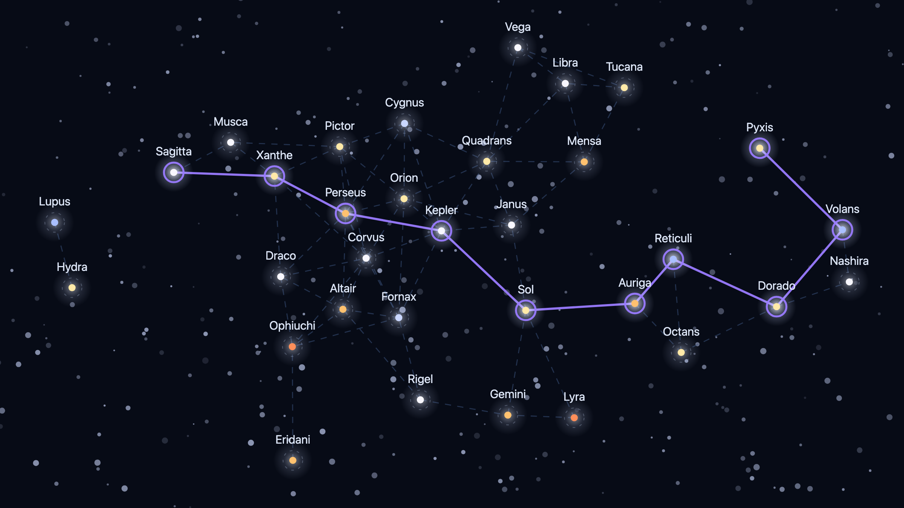

# starmap

**Two small libraries for star universes, in JavaScript and TypeScript.** One
describes your galaxy and answers questions about it. The other draws it.

### 📖 [Read the documentation →](https://starmap.industrieh.dev)



<sub>Not an illustration: 33 systems scattered from a seed, joined by
hyperlanes, with the longest route the network holds highlighted — drawn by
`renderGalaxy()`. Regenerate it with `bun run hero`
([source](scripts/hero-image.ts)).</sub>

```bash
bun add @industrieh/starmap @industrieh/starmap-render
```

```ts
import { createGalaxy, findRoute } from '@industrieh/starmap'
import { renderGalaxy } from '@industrieh/starmap-render'

const galaxy = createGalaxy({
  systems: [
    { id: 'sol', name: 'Sol', x: 0, y: 0, star: { class: 'G', radius: 18 } },
    { id: 'vega', name: 'Vega', x: 400, y: 300, star: { radius: 14 } },
  ],
  lanes: [{ from: 'sol', to: 'vega' }],
})

findRoute(galaxy, 'sol', 'vega') // { systemIds: ['sol', 'vega'], distance: 500, jumps: 1 }
renderGalaxy(galaxy) // '<svg …>' — a string, nothing else
```

You write a plain object. The library fills in the ids, the distances and the
counts, tells you where every planet is at any moment — and, if you want it,
hands the whole thing back as an SVG.

**No dependencies. No DOM. No framework.** The same code runs in a browser, in
Node or Bun, in a worker, on a server, under React Native, or inside a game
engine.

MIT · TypeScript · [documentation](https://starmap.industrieh.dev) ·
[npm](https://www.npmjs.com/package/@industrieh/starmap)

---

## Contents

- [The two libraries](#the-two-libraries)
- [Install](#install)
- [Your first galaxy](#your-first-galaxy)
- [Draw it](#draw-it)
- [What they will not do](#what-they-will-not-do)
- [Documentation](#documentation)
- [Working with an AI](#working-with-an-ai)
- [Try it locally](#try-it-locally)
- [Contributing](#contributing)
- [License](#license)

---

## The two libraries

They are separate packages, published separately, and you can stop after the
first one.

| package                                                 | what it is      | what it gives you                                                 |
| ------------------------------------------------------- | --------------- | ----------------------------------------------------------------- |
| [`@industrieh/starmap`](packages/starmap)               | **the model**   | describe a universe, have it checked and completed, then query it |
| [`@industrieh/starmap-render`](packages/starmap-render) | **the drawing** | turn that universe into an SVG string, at any moment in time      |

**Which one do you need?**

- You are writing a game and want a data structure for your galaxy — systems,
  planets, hyperlanes, routes, orbits. → **`starmap` alone.** Draw it however you
  already draw things.
- You also want a picture without writing SVG by hand. → **both.** The renderer
  depends on the model, so installing it brings the model along.

You never need `starmap-render` on its own: it draws universes the model
produces, and nothing else.

---

## Install

Pick your package manager. The second package is optional.

```bash
# Bun
bun add @industrieh/starmap @industrieh/starmap-render

# npm
npm install @industrieh/starmap @industrieh/starmap-render

# pnpm
pnpm add @industrieh/starmap @industrieh/starmap-render

# yarn
yarn add @industrieh/starmap @industrieh/starmap-render
```

Only the model:

```bash
bun add @industrieh/starmap
```

> **These are beta releases.** The current version is `0.1.0-beta.0`. The API is
> settled enough to build on, but a minor version may still move it before
> `1.0.0`. Pin the exact version if that matters to you.

**What they need from you**

| requirement          | detail                                                                        |
| -------------------- | ----------------------------------------------------------------------------- |
| a JavaScript runtime | any one. Node ≥ 18, Bun, Deno, a browser, a worker, React Native              |
| ES modules           | the packages ship ESM only. There is no CommonJS build                        |
| TypeScript           | optional, 5 or later. The libraries are plain JavaScript at runtime           |
| a build step         | none of your own — they ship pre-built, and your bundler treats them normally |

Without a bundler at all, they load straight from a CDN:

```html
<script type="module">
  import { createGalaxy } from 'https://esm.sh/@industrieh/starmap'
</script>
```

---

## Your first galaxy

Five steps, and after them you have used most of what the model does.

### 1. Describe it

Write what you know. Leave out everything the library can work out for itself —
planet ids, hyperlane lengths, the counters.

```ts
import { createGalaxy } from '@industrieh/starmap'

const galaxy = createGalaxy({
  systems: [
    {
      id: 'sol',
      name: 'Sol',
      x: 0,
      y: 0,
      star: { class: 'G', radius: 18 },
      planets: [
        { name: 'Sol I', type: 'rocky', orbit: 90, radius: 5, period: 12 },
        { id: 'earth', name: 'Earth', type: 'terran', orbit: 150, radius: 6, period: 24 },
      ],
    },
    { id: 'vega', name: 'Vega', x: 400, y: 300, star: { class: 'A', radius: 22 } },
  ],
  lanes: [{ from: 'sol', to: 'vega' }],
})
```

`createGalaxy()` does two things: it **completes** what you wrote, and it
**checks** it. A duplicate id, a lane pointing at a system that does not exist, a
radius below zero — it throws a `GalaxyValidationError` listing _every_ problem
at once, with the path to each.

### 2. See what it filled in

```ts
galaxy.meta.systemCount // 2
galaxy.systems[0].planets[0].id // 'sol-p0' — you did not name it, so it was numbered
galaxy.systems[0].planets[1].id // 'earth' — you did, so it was kept
galaxy.lanes[0].length // 500 — computed from the two positions
```

Give an id to anything your game will remember. A generated one is stable, but
it shifts if you later insert a planet before it.

### 3. Ask it questions

```ts
import { findRoute, indexGalaxy, neighboursOf } from '@industrieh/starmap'

findRoute(galaxy, 'sol', 'vega') // { systemIds: ['sol', 'vega'], distance: 500, jumps: 1 }
neighboursOf(galaxy, 'sol') // the systems one jump away — whole objects, not ids

// One Map holding every object of the galaxy, keyed by id.
const index = indexGalaxy(galaxy)
index.get('earth') // { kind: 'planet', obj: { … }, systemId: 'sol' }
index.get('vega')?.obj.name // 'Vega'
```

Build the index once and keep it. Walking the arrays on every frame is the one
easy way to make this slow.

### 4. Move it

Planets orbit. Give the library a time in seconds and it tells you where
everything is.

```ts
import { systemPositions } from '@industrieh/starmap'

// A Map of id → position, for everything that moves in that system.
const at = systemPositions(galaxy.systems[0], 6) // t = 6 seconds
at.get('earth') // { x: 0, y: 150 } — a quarter of the way round
at.get('sol-p0') // { x: -90, y: 0 } — half, its period is shorter
```

There is no clock inside the library and no call to `Date`. **Your loop owns
time** — which is what lets it pause, scrub backwards, or run faster than real
life.

### 5. Keep your game state next to it

A galaxy is the terrain: it does not change while you play. Your ship's
position, a station's stock, who owns what — that is game state, and it lives in
your own object, keyed by the same ids.

```ts
const ownership = new Map([['earth', 'player']])
```

---

## Draw it

The second package turns any of that into an SVG **string**.

```ts
import { renderSystem, renderGalaxy } from '@industrieh/starmap-render'

renderGalaxy(galaxy) // the map: systems as points, lanes between them
renderSystem(galaxy.systems[0], { t: 6 }) // one system, planets placed at t = 6s
```

A string, not a component. A component would pick a framework for you; a string
goes anywhere:

```ts
await Bun.write('sol.svg', renderSystem(system)) // a file
element.innerHTML = renderGalaxy(galaxy) // a page
const uri = `data:image/svg+xml,${encodeURIComponent(renderGalaxy(galaxy))}` // an 
```

In React: `dangerouslySetInnerHTML={{ __html: renderGalaxy(galaxy) }}`. Every
name in the output is escaped on the way out, so a system called `Ohm & Sons`
cannot break the document.

Colours come in through a theme, merged over the default key by key:

```ts
renderSystem(system, {
  theme: { background: '#000', planets: { terran: '#7ee787' } },
})
```

> **Two drawings on one page need two `idPrefix` values.** SVG ids are global to
> a document, so two systems sharing a prefix would both use the first one's star
> colour. Pass `{ idPrefix: system.id }`.

---

## What they will not do

Knowing this up front saves an afternoon.

| the libraries do not…          | because                                                                             |
| ------------------------------ | ----------------------------------------------------------------------------------- |
| **generate universes**         | the shape of a galaxy is game design. `createRng()` is here for your generator      |
| **draw, in the core**          | there is no `color` and no `typeName` in the data model, on purpose                 |
| **handle clicks, pan or zoom** | that is application state. `data-id` on every object is the hook; the rest is yours |
| **run a clock**                | you pass `t`; the library places things                                             |
| **judge your world**           | overlapping planets and a split network are accepted — they may be intentional      |

The model rejects what makes a universe _unusable_ (duplicate ids, dangling
references, values out of range) and accepts what is merely _implausible_.

One rule settles most surprises:

> **It computes what is derivable, and never invents a value that carries
> meaning.** It can work out that your second planet is `sol-p1`. It cannot work
> out that it is a gas giant, so it leaves `type` undefined.

---

## Documentation

| where                                                                    | what you get                                            |
| ------------------------------------------------------------------------ | ------------------------------------------------------- |
| **[starmap.industrieh.dev](https://starmap.industrieh.dev)**             | the full site — 21 pages, both libraries, real drawings |
| [`packages/starmap/README.md`](packages/starmap/README.md)               | the model's tour and full API tables                    |
| [`packages/starmap/docs/`](packages/starmap/docs)                        | data model, recipes, design decisions, architecture     |
| [`packages/starmap-render/README.md`](packages/starmap-render/README.md) | the renderer's tour and options                         |
| [`packages/starmap-render/docs/`](packages/starmap-render/docs)          | drawing, theming, framing, recipes                      |

### Working with an AI

These libraries are younger than the training data of most assistants, so a
model asked about them cold will invent an API that looks plausible and does not
exist. Two files prevent that:

| file                                                             | what it is                                                     |
| ---------------------------------------------------------------- | -------------------------------------------------------------- |
| [`/llms.txt`](https://starmap.industrieh.dev/llms.txt)           | the map — every documentation page with a one-line description |
| [`/llms-full.txt`](https://starmap.industrieh.dev/llms-full.txt) | everything — both READMEs and every guide in one file, ~120 KB |

In an agent that reads project instructions — Claude Code, Cursor, Copilot —
one line is enough:

```md
When writing code against @industrieh/starmap or @industrieh/starmap-render,
read https://starmap.industrieh.dev/llms-full.txt first.
```

In a chat, paste the URL. Offline, download the file and attach it.

---

## Try it locally

You do **not** need to clone this repo to use the libraries — that is what
`bun add` above is for. Clone it to read the source, run the examples, or
contribute.

```bash
git clone git@github.com:Industrieh/starmap.git
cd starmap
bun install
```

[Bun](https://bun.com) is the only thing to install. Then:

| I want to…                  | run                   | what happens                                           |
| --------------------------- | --------------------- | ------------------------------------------------------ |
| **see it move**             | `bun run dev`         | the playground on http://localhost:5173 — fly a galaxy |
| **read the docs**           | `bun run docs`        | the documentation site on http://localhost:3000        |
| **see the code work**       | `bun run example`     | prints a universe to the terminal, in ~60 lines        |
| **get an SVG file**         | `bun run example:svg` | writes four `.svg` files you can open                  |
| **check nothing is broken** | `bun run check`       | format + lint + types + tests, across the whole repo   |

New here? `bun run dev` first — it is the fastest way to understand what these
libraries are for.

---

## Contributing

Contributions are welcome. Each package also has its own guide, with the
checklists for the changes people actually make:
[`packages/starmap/CONTRIBUTING.md`](packages/starmap/CONTRIBUTING.md) ·
[`packages/starmap-render/CONTRIBUTING.md`](packages/starmap-render/CONTRIBUTING.md).

### Setting up

```bash
git clone git@github.com:Industrieh/starmap.git
cd starmap
bun install
bun run check   # if this passes on a clean checkout, your setup is good
```

### The repo map

```
packages/     what gets published to npm
apps/         what gets deployed
examples/     what never leaves the repo
```

| folder                                                           | package                                    | what it is                                             |
| ---------------------------------------------------------------- | ------------------------------------------ | ------------------------------------------------------ |
| [`packages/starmap`](packages/starmap)                           | `@industrieh/starmap`                      | **the core** — describe, validate and query a universe |
| [`packages/starmap-render`](packages/starmap-render)             | `@industrieh/starmap-render`               | **the renderer** — a galaxy or a system, as SVG        |
| [`apps/docs`](apps/docs)                                         | `@industrieh/docs`                         | the documentation site, on Next.js — `private`         |
| [`examples/basic`](examples/basic)                               | `@industrieh/example-basic`                | describe a universe and query it — `private`           |
| [`examples/basic-svg-generation`](examples/basic-svg-generation) | `@industrieh/example-basic-svg-generation` | draw it as SVG files — `private`                       |
| [`examples/playground`](examples/playground)                     | `@industrieh/example-playground`           | the full React app — `private`                         |

A package's folder says **what happens to it**. `packages/` is versioned and
published, so its public API is a commitment. `examples/` is `private` and will
never be installed by anyone, so it can break freely. `apps/` gets deployed and
never installed.

It is a [Bun workspaces](https://bun.com/docs/guides/install/workspaces)
monorepo — one `bun install` at the root wires everything together.

### Commands

All of them run from the root.

| command               | what it does                                  |
| --------------------- | --------------------------------------------- |
| `bun run dev`         | opens `examples/playground`, the full app     |
| `bun run docs`        | opens `apps/docs`, the documentation site     |
| `bun run example`     | runs `examples/basic`                         |
| `bun run example:svg` | runs `examples/basic-svg-generation`          |
| `bun run build`       | builds every package, **in dependency order** |
| `bun run test`        | tests every package — 196 tests today         |
| `bun run typecheck`   | `tsc --noEmit` on every package               |
| `bun run lint`        | oxlint, one pass over the repo                |
| `bun run fmt`         | oxfmt, one pass over the repo                 |
| `bun run check`       | the four above, in order                      |
| `bun run hero`        | redraws the galaxy at the top of this README  |

To target a single package:

```bash
bun run --filter '@industrieh/starmap' test
bun run --filter './packages/*' build
```

`bun run check` is what CI runs. Run it before you push — `fmt:check` fails on
formatting that `bun run fmt` would have fixed for you.

`bun run hero` is the odd one out: it generates a galaxy from a fixed seed and
draws it into `assets/`, which is where the picture at the top of this file comes
from. The seed makes it reproducible, so re-running it changes nothing unless the
renderer did. The SVG step needs nothing; turning it into a PNG needs Playwright,
which is not a dependency of this repo — the script says so and stops there if it
is missing.

```bash
bun add -d playwright && bunx playwright install chromium   # only to redraw the PNG
```

### Sending a change

```bash
git checkout -b feat/short-description
# ... work ...
bun run check
bun run changeset
git commit -m "feat: add richness to asteroid clusters"
```

Commits follow [Conventional Commits](https://www.conventionalcommits.org):
`feat:`, `fix:`, `docs:`, `test:`, `refactor:`, `chore:`.

One concern per pull request. A field addition and a refactor in the same branch
are two reviews pretending to be one.

**A pull request that changes a published package carries a changeset.**
`bun run changeset` asks which packages moved, how big the bump is, and for a
summary; it writes a file in `.changeset/` that you commit with your change.
Without one, the change is merged and never released. Docs, tests, CI, and
anything touching only `apps/` or `examples/` need none.

Never edit a `version` field by hand — that is what `changeset version` is for,
and doing it manually desynchronises the changelogs.

### How a release happens

1. Changesets land on `main`.
2. A bot opens a `chore: version packages` pull request that applies them: it
   bumps the versions, writes the `CHANGELOG.md` files and deletes the
   changesets. **Merging it is what decides a release exists.**
3. Publishing a GitHub release from the resulting commit runs the full check
   suite and, if green, publishes to npm.

The repo is in pre-release mode ([`.changeset/pre.json`](.changeset/pre.json),
tag `beta`), so bumps come out as `0.1.0-beta.N`. `bun run changeset:status`
lists what is waiting; `bun run release:dry-run` says what would be published
without publishing anything.

### The four conventions worth knowing

**Packages resolve to their sources.** `tsconfig.base.json` points every package
at its `src/`, not its `dist/`, so typechecking one does not require building
another and a stale `dist/` cannot produce phantom errors. Bun honours those
paths at runtime too — `bun run example` needs no build. Vitest and Vite do not
read them, so a package that depends on another repeats the alias in its
`vitest.config.ts` or `vite.config.ts`. _Adding a package means adding its entry
to `paths`._

**Every exported declaration carries an explicit type.** `isolatedDeclarations`
is on: `export function f(x: number)` does not compile, it has to be
`export function f(x: number): string`. It keeps the public API written down
rather than inferred — and it makes tsdown pick `oxc` for declarations, which
generates them in memory instead of writing intermediate `.d.ts` files next to
your sources.

**Tooling at the root, dependencies in the packages.** TypeScript, oxlint, oxfmt
and `@types/node` are root devDependencies — one version for the whole repo.
What a package needs to build or test itself lives in its own `package.json`.
Packages reference each other with `workspace:*`.

**Every package stands alone.** Its own `package.json`, `tsconfig.json`, build
and test config, README and CONTRIBUTING. Only formatting, linting and tooling
versions are shared.

### Looking at the documentation site

`apps/docs` is the one thing here that has to be _looked at_ rather than
asserted about, so the repo carries two ways to drive a real browser: the
[Playwright MCP server](.mcp.json), and the `webapp-testing` skill under
`.agents/skills/`. The skill needs a Python environment the repo does not
install for you:

```bash
python3 -m venv --without-pip .venv
curl -sSL https://bootstrap.pypa.io/get-pip.py | .venv/bin/python
.venv/bin/python -m pip install playwright
.venv/bin/python -m playwright install chromium
```

The site's drawings come from the packages' `dist/`, not their sources, so
`bun run docs` on a stale build draws yesterday's renderer. The root
`bun run build` orders it correctly.

### Reporting a bug

Include the smallest `GalaxyInput` that reproduces it, what you expected, and
what happened. If it threw, paste the whole `GalaxyValidationError` — it lists
every problem with its path, and the path is usually the answer.

### Stack

Bun · TypeScript 7 (`isolatedDeclarations`) · tsdown · Vitest · oxlint · oxfmt ·
Changesets · Next.js 16 · React 19 · Vite 8 · Tailwind CSS v4 · shadcn/ui

---

## License

[MIT](LICENSE) — use it in anything, including a game you sell.
